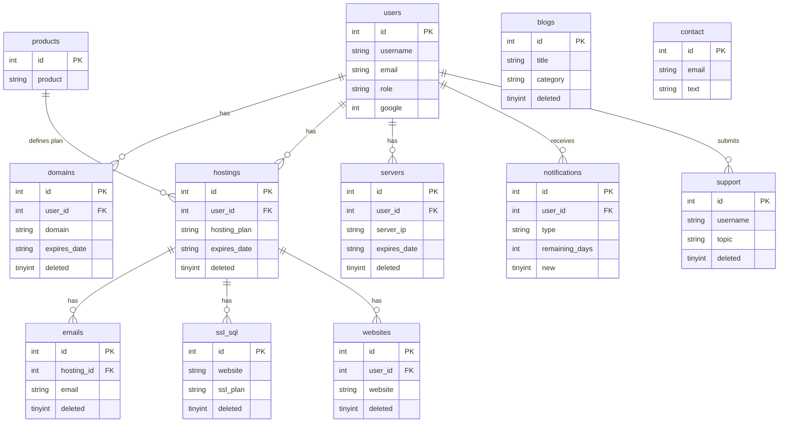

# BKSoftware Client Management Panel — Architecture

> **Note:** This repository contains only the database schema and architectural documentation.  
> Source code is closed-source. This repo exists to showcase the system design and technical decisions.

---

## What is this?

A multi-role client management panel built for [BK Software CO.](https://bksoftware.co), serving real customers since 2022. Admins assign and manage web services (domains, hosting, servers, SSL, e-mail) per customer, while customers track their own services from a single dashboard.

## Tech Stack

| Layer | Technology |
|---|---|
| Backend | PHP 8.x (Native) |
| Database | MySQL 8.4 |
| Auth | Google OAuth 2.0 |
| Security | Prepared Statements |

## Database Architecture

12 tables, with soft delete (`deleted` flag) where applicable:

| Table | Purpose |
|---|---|
| `users` | User accounts with role, profile photo, and Google auth flag |
| `domains` | Domain registrations per customer, with expiry date |
| `hostings` | Hosting plans per customer, with expiry date |
| `servers` | Server assignments with IP, plan, and expiry date |
| `ssl_sql` | SSL certificate assignments with plan and expiry date |
| `emails` | E-mail addresses linked to hosting accounts |
| `websites` | Website records linked to customers |
| `notifications` | Auto-generated expiry alerts per user and service |
| `products` | Product catalog (hosting plans, SSL plans, etc.) |
| `blogs` | Blog posts with soft delete |
| `support` | Support tickets submitted by customers |
| `contact` | Contact form submissions |

## Key Technical Decisions

**Soft Delete:** Every service table uses a `deleted` flag instead of hard deletes, keeping historical records intact.

**Automated Notifications:** When a domain, hosting, or SSL approaches expiry, the system creates a notification record with `remaining_days` and `new = 1`. Customers see these on their dashboard.

**RBAC:** The `role` field on `users` drives a 4-tier access system: admin, blogger, support staff, and customer — handled entirely in PHP without a framework.

**Google OAuth 2.0:** The `google` flag on `users` distinguishes Google-authenticated accounts from password-based ones.

---

## ER Diagram

*Built by [Furkan Yaşar](https://linkedin.com/in/furkan-yasar0)*

---

# BKSoftware Müşteri Yönetim Paneli — Mimari

> **Not:** Bu repo yalnızca veritabanı şemasını ve mimari dokümantasyonu içermektedir.  
> Kaynak kod kapalı kaynaklıdır.

---

## Bu Nedir?

[BK Software CO.](https://bksoftware.co) için 2022'den bu yana geliştirilen ve gerçek müşterilere hizmet veren çok rollü bir müşteri yönetim panelidir. Adminler müşterilere domain, hosting, sunucu, SSL ve e-posta gibi hizmetler atayıp yönetirken, müşteriler kendi hizmetlerini tek bir panelden takip eder.

## Teknoloji Yığını

| Katman | Teknoloji |
|---|---|
| Backend | PHP 8.x (Native) |
| Veritabanı | MySQL 8.4 |
| Kimlik Doğrulama | Google OAuth 2.0 |
| Güvenlik | Prepared Statements |

## Veritabanı Mimarisi

12 tablo, uygun olduğu yerlerde soft delete (`deleted` bayrağı) ile:

| Tablo | Amaç |
|---|---|
| `users` | Kullanıcı hesapları, rol, profil fotoğrafı, Google auth bayrağı |
| `domains` | Müşteri başına domain kayıtları ve bitiş tarihleri |
| `hostings` | Müşteri başına hosting planları ve bitiş tarihleri |
| `servers` | IP, plan ve bitiş tarihi içeren sunucu atamaları |
| `ssl_sql` | Plan ve bitiş tarihi içeren SSL sertifika atamaları |
| `emails` | Hosting hesaplarına bağlı e-posta adresleri |
| `websites` | Müşterilere bağlı website kayıtları |
| `notifications` | Kullanıcı ve hizmet başına otomatik oluşturulan bitiş uyarıları |
| `products` | Ürün katalogu (hosting planları, SSL planları vb.) |
| `blogs` | Soft delete'li blog yazıları |
| `support` | Müşterilerin açtığı destek talepleri |
| `contact` | İletişim formu başvuruları |

## Teknik Kararlar

**Soft Delete:** Her hizmet tablosu hard delete yerine `deleted` bayrağı kullanır, geçmiş kayıtlar korunur.

**Otomatik Bildirimler:** Domain, hosting veya SSL bitiş tarihine yaklaşınca sistem `remaining_days` ve `new = 1` içeren bir bildirim kaydı oluşturur. Müşteriler bunu panellerinde görür.

**RBAC:** `users` tablosundaki `role` alanı 4 katmanlı bir erişim sistemi yönetir: admin, blogger, destek ekibi ve müşteri — framework olmadan tamamen PHP ile.

**Google OAuth 2.0:** `users` tablosundaki `google` bayrağı Google kimlik doğrulamalı hesapları parola tabanlı hesaplardan ayırır.

---

## ER Diagram

*Built by [Furkan Yaşar](https://linkedin.com/in/furkan-yasar0)*
